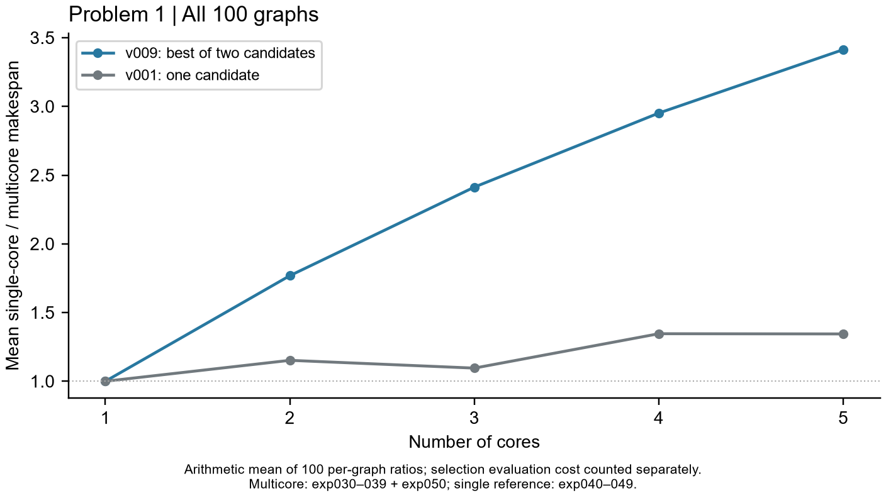

# A 题第一问运行结果

截至 2026-09-25，第一问的 v009 全量评估已完成并核对。这里汇总可直接用于查看和写作的结果；逐次运行方案、日志、源码快照和历史版本按解题步骤保存在 [`../outputs/`](../outputs/) 中。

## 覆盖范围

- 100 张计算图，2～5 核共 400 个多核配置：400 项成功。
- v009 对每个配置分别评估 v001、v008，共 800 个候选：800 项成功。
- 100 个单核参考：100 项成功。本轮没有算法失败或超时；另有 1 次用户主动暂停造成的评估中断，恢复记录单独保留。

## 主要结果

平均加速比是对每张图先计算“单核 Makespan ÷ 对应多核 Makespan”，再对 100 张图取算术平均。

| 核数 | v009 平均加速比 | v001 平均加速比 | v009 相对单核快 / 平 / 慢 |
|---:|---:|---:|---:|
| 2 | 1.7684 | 1.1523 | 96 / 0 / 4 |
| 3 | 2.4128 | 1.0957 | 94 / 0 / 6 |
| 4 | 2.9518 | 1.3460 | 98 / 0 / 2 |
| 5 | 3.4136 | 1.3444 | 99 / 0 / 1 |

v009 在 400 个配置中选择 v008 方案 360 次、v001 方案 40 次；相对同次运行的 v001 多核基线，360 项更快、40 项持平、0 项更慢。v009 的规则是**两种候选都生成并评估后择优**，因此这种不退步是选择规则的结果，不能解释为等预算下单个算法的优势。多核累计已记录求解耗时为 6666.312 秒，其中生成 412.574 秒、评估 6202.478 秒；一次人工中断前的耗时未完整落盘，因此该累计值是下界。

## 文件与边界

- [第一问全量结果](../outputs/08_full/README.md)放最终比较表、单核参考表、候选明细、均值来源和可编辑图表的便览副本。
- [v009 原始全量报告](../outputs/08_full/raw/problem_1/v009/full_summary_20260924/REPORT.md)及其 `manifest.json`、各批次方案、日志和源码快照是完整追溯依据；[完成核对记录](../outputs/08_full/raw/problem_1/v009/completion_audit_20260925.json)记录覆盖、哈希和均值复算。
- [历史实验目录](../experiments/INDEX.md)记录 v001 至 v009 的实验和阶段状态。各步骤 `raw/scratch` 是探索性诊断，不纳入正式全量统计。
- 第一问的数学模型、伪代码及论文结果分析尚待整理；第二、三问尚未开展。
