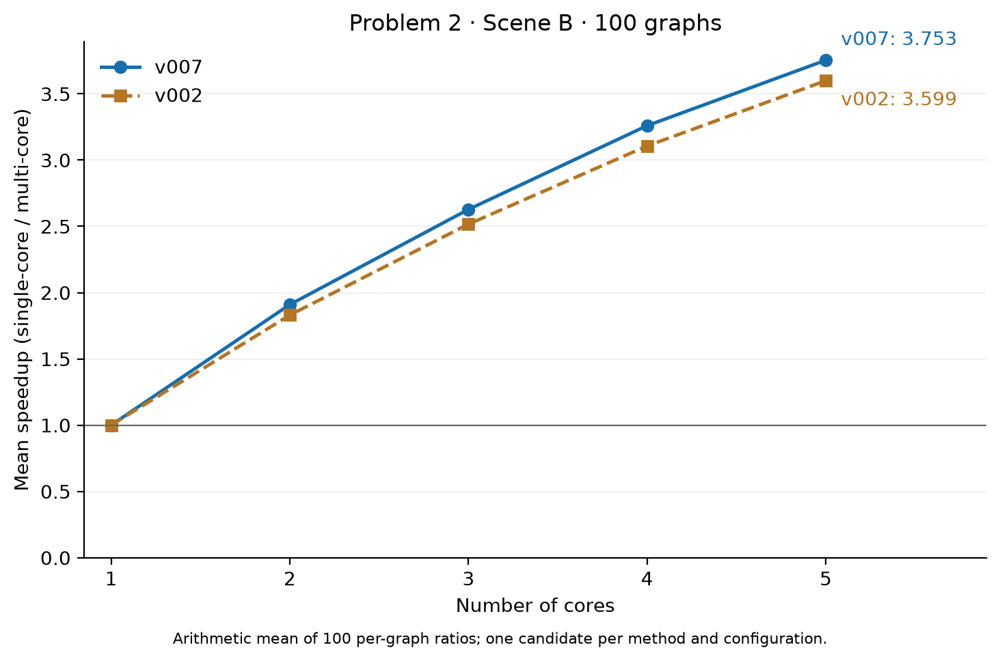

# 第二问全量评估

共 900 个评估配置：v007 400 个、v002 对照 400 个、场景 B 单核 100 个。成功 900，失败/超时 0。

v007 保持原区域方法的分核，多分量图每次交错安排两个独立分量；单连通图沿用原方法。两方法每配置均只生成并评估一个候选，生成/评估预算 30/180 秒，无自动重试。

| 核数 | v007 平均加速比 | v002 平均加速比 | v007 比单核快 / 平 / 慢 |
|---|---:|---:|---|
| 1 | 1.0000 | 1.0000 | 0 / 100 / 0 |
| 2 | 1.9095 | 1.8305 | 99 / 0 / 1 |
| 3 | 2.6277 | 2.5165 | 100 / 0 / 0 |
| 4 | 3.2597 | 3.1063 | 100 / 0 / 0 |
| 5 | 3.7534 | 3.5991 | 100 / 0 / 0 |

平均加速比先按每张图计算“单核时间 / 多核时间”，再对全部 100 张图取算术平均。分母缺失时不报告完整均值。

v007 相对 v002：251 快、85 平、64 慢、0 不可比较。全量退步配置不能被开发集和新检验集的改善掩盖。

## 相对 v002 退步最大的配置

| 图 | 核数 | v002 Makespan | v007 Makespan | 耗时增加 |
|---|---:|---:|---:|---:|
| case_079 | 5 | 6162906 | 7601057 | 23.34% |
| case_079 | 4 | 7761360 | 9181684 | 18.30% |
| case_079 | 3 | 9906691 | 11683215 | 17.93% |
| case_021 | 5 | 1256739 | 1458801 | 16.08% |
| case_079 | 2 | 14853842 | 16917238 | 13.89% |

v007 共 1 个配置慢于对应单核参考；详细记录单列，不将这些配置从均值中剔除。

## 求解成本

| 方法 | 生成秒数 | 评估秒数 |
|---|---:|---:|
| v007 | 177.715 | 842.592 |
| v002 | 126.530 | 686.650 |
| single_v001 | 14.079 | 187.902 |

## 完整性与边界

- 100 张图及全部核数组合覆盖、输入/配置/代码冻结哈希、方案/结果/日志和源码快照哈希均已核对。
- 本轮场景 B 一核结果中 100 项与第一问归档的官方单核入口成绩逐图一致；对应原始输入和配置哈希一致。加速比分母按题目两问相同定义使用；这项数值核对不主张两个评估器在任意输入上等价。
- 成功结果逐项检查操作覆盖、核数、正 Makespan、内存容量峰值和跨核 COPY 等待至少 500 cycles；这些检查不代替对整个评估器的形式证明。
- 完整逐图表为 all_results.csv；比较及搬运量为 comparison.csv；图的数据源为 mean_speedup.csv。
- 每项方案和完整原始结果的路径列在 all_results.csv；原始实验保留于上一级 raw/problem_2/。
- [v007_plans.zip](v007_plans.zip) 包含 400 个成功的 v007 方案，逐文件核对与原始方案相同。
- v007 比单核慢的项列在 slower_than_single.csv（如有）；失败/超时列在 failed_attempts.csv（如有）。
- 全量包含此前的开发与检验图，不能作为另一份独立检验证据；仅对本题固定配置下的模拟结果作结论。
