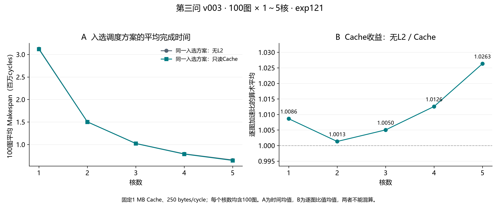
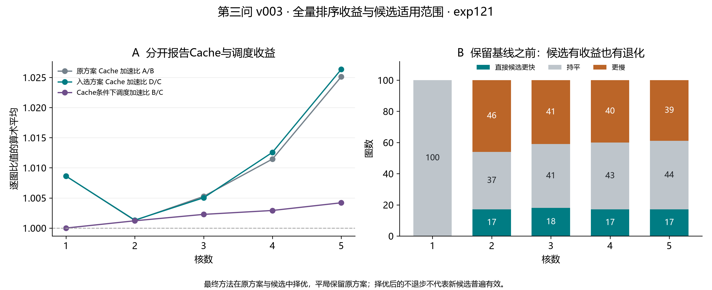

# 第三问 v003：全100图评估报告

## 完成情况与结论

已覆盖 **100图 × 1～5核，共500个配置**。每个入选方案均有同方案无L2/Cache结果，原方案A/B对照也齐全。全部500配置通过独立审计，无缺失、失败或超时。采用原始评估器与固定配置；算法及候选预算全程冻结。

直接新候选：**69项更快、265项持平、166项更慢**。最终与原方案择优后，**69项改善、431项持平**。直接候选最差耗时增加157.862%，因此不能省略原方案比较。

最大调度改善出现在case_039、4核：428213→379457 cycles，减少11.386%。这只是最大单项，不代表平均收益。

## Cache对照曲线

左图是100图Makespan的算术平均；右图先计算每图无L2/Cache比值再求平均。二者是不同聚合指标，不能用平均时间之比代替右图。每个核数上的无L2和Cache评估使用完全相同的入选方案。核数指可用核预算，方案允许包含空闲核，不保证所有核都分配工作。

## 调度优化的收益与边界

主方法仍为固定的baseline+width1，两候选按Cache Makespan择优、平局保留baseline；未根据全量成绩改变排序或参数。小规模开发及预留检验的等预算width2对照已保留于exp116/117；本次全量没有追加该对照。

## 计算成本

新增候选生成500次，累计139.206秒；实际新增评估914次，累计2071.088秒。外部哈希核验复用624份结果，同方案内部去重462份结果。

执行循环墙钟2773.995秒，不含归档初始化、索引构建、审计和作图。Q2起点及旧Q3结果的上游搜索/评估成本不为零，来源保留在原始manifest；此处不声称是冷启动总成本。算法求解秒数与Makespan cycles分开报告。

## 核验与已知限制

- 500配置完整覆盖；方案归属与分核、依赖合法性、结果哈希、固定Cache容量、跨核等待和命中率口径均已核对。逐图比较表重新选择最低Cache Makespan，平局保留baseline。
- 新入口已通过超时及手动中断清理、结果篡改拒绝、并发锁、断点恢复和重复启动检查。禁用复用重新计算的四份完整JSON与旧结果一致。旧冻结入口保留原样；本轮使用新进程树清理入口。
- 原评估器命中读取完成后的重新插入行为继续沿用并披露。逐候选事件计数见summary.json。官方额外搬运量不解释为Cache后的实际DDR流量。
- Cache可能使部分固定方案变慢，按核数的快/平/慢计数完整保留。全100图包含开发和预留图，是题目数据集的完整覆盖，不能称新的未见测试集或全局最优证明。

## 交付文件

- `comparison.csv`：500配置的A/B/C/D Makespan、命中率、额外搬运、选择结果与原始结果路径。
- `figure_data.csv`：两组图的全部聚合数据；`figures/`：PNG、SVG、PDF。
- `selected_plans.zip`：500个入选方案，文件名包含用例及核数。
- `summary.json`：覆盖、成本、失败清单、每核数指标与评估器特殊行为计数。
- `METHOD.md`和`PREFLIGHT.md`：算法范围及全量前检查；[事后空间分析](posthoc/REPORT.md)由analyze_problem3_headroom.py单独生成。
- 原始完整目录：`D:\workspace\HuaWei\A题\solution\outputs\10_problem3\raw\problem_3\v003\exp121_20260926_v003_full`，包含全部候选、完整评估JSON、日志、源码快照、来源及复现命令。

五核下逐图耗时降幅的平均值为0.3940%，说明当前排序改进总体较小。当前保留这版有基线保护、可复现的算法，下一步整理第三问的模型、算法说明与结果分析。若进一步优化，应先从事后分析中筛选仍有空间且具有具体搬运/等待证据的配置，不直接再次进行全图调参。
